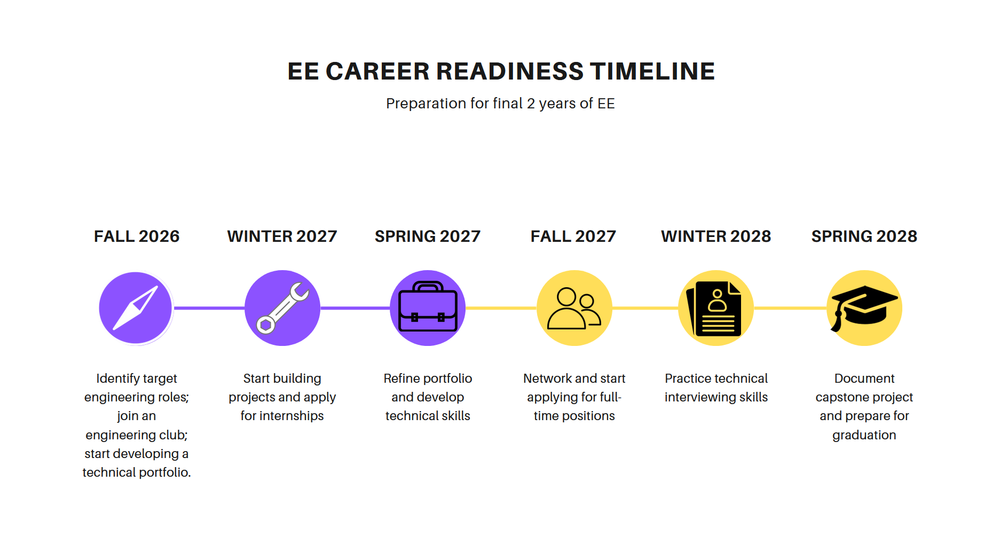

# Preparing for a Career in Technical Sales Engineering

**A Two-Year Career Preparation Plan**

Gari Garcia  
University of Washington Bothell  
CSS 301 | Fall 2026

---

## Table of Contents

- [Purpose](#purpose)
- [Developing Technical Expertise](#developing-technical-expertise)
- [Building Communication and Sales Skills](#building-communication-and-sales-skills)
- [Gaining Professional Experience](#gaining-professional-experience)
- [Planning the Final Two Years](#planning-the-final-two-years)
- [Preparing for Employment](#preparing-for-employment)
- [References](#references)

---

## Purpose

There is more than just an understanding of electrical engineering principles that you need when pursuing a career in technical sales engineer. You need to know how to communicate technical information effectively, know your customer's needs, and show how engineering products can satisfy their needs. Your required coursework will built your technical foundation, however you need more professional development as well to help set you apart from other applicants. Having relevant experience throughout your final two years as an electrical engineering student can help further develop your technical and interpersonal skills which is crucial for sales engineers [^1]. This report will outline the best practices for developing the necessary knowledge, professional skills, and experience to pursue a career in technical sales engineering after graduating.

## Developing Technical Expertise

The best way to go about developing technical expertise is through projects as well as hands-on experimentation. For example, building circuits, testing different electrical components, or even using different simulation software can help build your ability to evaluate different types of engineering products. Documenting those experiences in a portfolio helps in providing evidence of your ability to problem solve. As opposed to just describing what you built, go into detail about any issues you encountered, how you went about your decision making, and how your final solution served as the fix. 

## Building Communication and Sales Skills

Practicing technical presentations as well as developing active listening habits can help strengthen your communication skills significantly. This can be presenting your projects to your peers, actively participating in group discussions, and even explaining some technical concepts to people that aren't in engineering. All of which can greatly help you to adapt your communication style to various audiences. When you present a solution, you should put emphasis on how its features address a specific need as opposed to focusing on just the technical aspects. Experiences like this can help you build your confidence when you interact with future clients.

## Gaining Professional Experience

You should pursue internships and networking events such as career fairs that are related to engineering and technical sales. Positions where you have to apply engineering, product support, or technical sales are great ways to gain relevant experience. Participating in engineering clubs and attending career fairs are opportunities for you to connect with professionals in the industry. When looking into these opportunities, you should prioritize the experiences that involve both technical problem solving as well as customer engagement.

## Planning the Final Two Years

Consistent development throughout your final two years is necessary in order to prepare for a career in technical sales. As opposed to waiting for the last minute to prepare for graduation, you should spread different goals across each quarter. Figure 1 shows an example of progression from exploring career opportunities and developing your technical skills to pursuing experience and getting ready for graduation. This approach helps you gradually build your qualifications while you complete your degree at the same time.

**Figure 1. Electrical Engineering Career Readiness Timeline**

## Preparing for Employment

You should prepare for employment by tailoring your resume, portfolio, and your interview responses to the standards of technical sales positions. Focus on engineering projects, internships, and experiences that involve customer engagement. If you talk about technical projects, explain what the issue was, your method, and what the outcome was. Practicing technical interview questions can help communicate your qualifications clearly. You can present yourself as someone who is capable of understanding both the product and people-side

## References

[1] U.S. Bureau of Labor Statistics, "Sales Engineers," U.S. Bureau of Labor Statistics, 27 August 2026. [Online]. Available: https://www.bls.gov/ooh/sales/sales-engineers.htm. [Accessed 27 October 2026].
