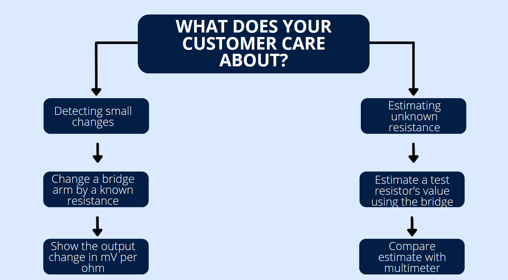

# Preparing for a Career in Technical Sales Engineering

**A Two-Year Career Preparation Plan**

© JohnRH4, <a href="https://commons.wikimedia.org/wiki/File:Electrical_Engineering_Lab_Station_(3955361228).jpg">Electrical Engineering Lab Station</a>, Wikimedia Commons, <a href="https://creativecommons.org/licenses/by-sa/2.0/">CC BY-SA 2.0</a>.

Gari Garcia  
University of Washington Bothell  
CSS 301 | Fall 2026

---

## Table of Contents

- [Purpose](#purpose)
- [Developing Technical Expertise](#developing-technical-expertise)
- [Building Communication and Sales Skills](#building-communication-and-sales-skills)
- [Gaining Professional Experience](#gaining-professional-experience)
- [Planning the Final Two Years](#planning-the-final-two-years)
- [Preparing for Employment](#preparing-for-employment)
- [References](#references)

---

## Purpose

There's more than just understanding of electrical engineering principles when pursuing a career in technical sales. You need to know how to communicate technical information effectively, know your customer's needs, and show how engineering products can satisfy their needs. Your coursework will build your technical foundation, however you need more professional development to help set you apart from other applicants. Having experience throughout your final two years as an electrical engineering student further develops your technical and interpersonal skills which is crucial for sales engineers [^1]. This report outlines best practices for developing necessary knowledge, professional skills, and experience to pursue a career in technical sales engineering.

## Developing Technical Expertise

The best way to develop technical expertise is through projects and hands-on experimentation. For example, building circuits, testing different electrical components, or even using different simulation software can help build your ability to evaluate different types of engineering products. 

**Build a portfolio study around a design decision.** You should use a personal project of circuit lab and record the requirement, any alternatives you considered, and measurements that support your choice. For example, you could compare two filters using gain at the frequency you want to preserve and the frequency you want to suppress.

## Building Communication and Sales Skills

That same circuit could support different recommendations based on what a customer might need. Someone that needs to detect any small changes in resistance cares about sensitivity while someone that has to estimate an unknown resistance cares more about accuracy. Figure 1 shows how a customer's needs determine what you show when demonstrating a Wheatstone bridge.

**Practice presentations with peers outside of engineering.** You can start by asking which result matters to them, show the appropriate measurement that addresses it, explain what that result means for their decision, then ask if they have any further questions about the recommendation you give them. Experiences like this can help you build your confidence when you interact with future clients.

**Figure 1. Demonstrating with a Wheatstone bridge**

## Gaining Professional Experience

Pursing an internship in sales engineering gives you an environment where technical choices have an affect on someone else's work. UW Bothell's engineering capstone offers opportunities to work on projects that are supplied by local companies [^2]. In either setting, you could see how client's requirements affect what you build, test, and explain.

**Prioritize positions and projects that combine technical work and customer-facing work.** You should look for roles that include responsibilities such as demonstrating equipment, measuring results, or even helping somebody choose between different components. You should ask recruiters or mentors who uses that work and how you receive feedback for it.

## Planning the Final Two Years

Some course prerequisites and application deadlines limit when you could pursue opportunities. Having a plan that's tied to those dates gives you time to build projects and document them before applications open. It also points out which activities to move if a course fills up or searching for an internship takes longer than expected.

**Assign a career milestone to each quarter with your degree requirements.** Set something that you could verify, such as a circuit case study, a demonstration, or a tailored application. Verify your plan before registration and move any activities that are flexible when a course you have to take or an application deadline takes priority. For example, if a class is full, use a case study that you already started to practice your demo that quarter and confirm alternate offerings with your advisor.

## Preparing for Employment

Technical sales postings might emphasize product demonstrations, or communicating with customers. Matching your experience to postings help employers see how you would be able to handle work. In an informational interview, Doug Comstock described securing a corporate waiver for tuition after changing his approach due to refusals. Comstock says, "Find something that you're interested in and passionate about so that when you get up to go to work every day, you're looking forward to it instead of dreading it." [^3]

**Tailor your resume, portfolio, and interview responses to each role**. Focus on projects, internships, and experiences that involve customer engagement. If you talk about technical projects, explain the issue, your method, and the outcome. Practicing interview questions helps communicate your qualifications clearly.

## References

[^1]: U.S. Bureau of Labor Statistics, "Sales Engineers," U.S. Bureau of Labor Statistics, 27 August 2026. [Online]. Available: https://www.bls.gov/ooh/sales/sales-engineers.htm. [Accessed 27 October 2026].
[^2]: University of Washington Bothell, “Capstones,” School of Science, Technology, Engineering & Mathematics, n.d. [Online]. Available: https://www.uwb.edu/stem/industry-partners/capstones-internships. [Accessed Nov. 24, 2026].
[^3]: Comstock, Doug. Personal interview. 22 October 2026.
[word count: 696]
